# 🛡️ TRINETRA

### AI-Powered Email Threat Detection, Geolocation & Forensic Intelligence Platform

> **Detect the Threat. Trace the Infrastructure. Preserve the Evidence.**


**Problem Statement:** TRINETRA · Blockchain & Cybersecurity  
**Organization:** AICTE Cyber Security Cell  
**Team:** Trinetra Team (6 members)  
**Live Sepolia Contract:** [`0x87f8CD4c4628D77aCDfb76Ee6428Fa98dc2dEed8`](https://sepolia.etherscan.io/address/0x87f8CD4c4628D77aCDfb76Ee6428Fa98dc2dEed8)

---

## 📌 What is TRINETRA?

Traditional email filters **block** threats. They don't **explain** them, **trace** them, or **prove** they happened.

TRINETRA is an explainable, forensic-grade email threat investigation platform. It ingests a suspicious `.eml` file, runs a deterministic analysis pipeline, and produces:

- A **threat score** with a transparent factor breakdown (no black-box verdicts)
- A **geolocation map** of the attacker's infrastructure (IP, ASN, ISP, country)
- A **Neo4j campaign correlation graph** linking related emails by shared infrastructure
- **Blockchain-anchored forensic evidence** (Sepolia testnet + Merkle proof)
- A **court-ready multi-format report** (PDF, HTML, Markdown, STIX 2.1)

> **The gap TRINETRA closes: Detection ≠ Investigation.**

---

## ✨ Feature Status

Every feature below is tagged honestly:

- ✅ **Shipped** — merged to main, working today
- 🟡 **Wired** — module exists but not yet called from the API
- 🔵 **In PR** — code complete on a branch, pending review
- ⏳ **Roadmap** — planned, not yet written

| Feature | Status | Notes |
|---------|--------|-------|
| ML phishing classifier (TF-IDF + LogisticRegression) | ✅ Shipped | `model.py` |
| XAI Contradiction Detection engine | ✅ Shipped | `xai_engine.py` |
| SPF / DKIM / DMARC / ARC header parsing | ✅ Shipped | `api.py` |
| Typosquat & homoglyph detection | ✅ Shipped | `backend/typosquat/` |
| RDAP fresh-domain lookup | ✅ Shipped | `backend/typosquat/rdap_lookup.py` |
| Parallel GeoIP + ASN enrichment | ✅ Shipped | `threat_intel.py` |
| NetworkX threat infrastructure graph | ✅ Shipped | `graph_engine.py` |
| Neo4j persistent campaign correlation | ✅ Shipped | `neo4j_engine.py` |
| SHA-256 + Merkle tree evidence proof | ✅ Shipped | `zkfv.py` |
| Solidity smart contract on Ethereum Sepolia | ✅ Shipped | `blockchain/contracts/TrinetraEvidence.sol` |
| Multi-format reporting (PDF / HTML / MD / STIX 2.1) | ✅ Shipped | `report_*.py` |
| Security hardening (zip bombs, MIME recursion, prompt injection) | ✅ Shipped | `security_hardening.py` |
| PII masking for DPDP Act 2023 | ✅ Shipped | `backend/reporting/pii_mask.py` |
| Chain-of-custody PDF with page numbers | ✅ Shipped | `report_gen.py` |
| Live threat intel feeds (VirusTotal, AbuseIPDB, Shodan, etc.) | ✅ Shipped | `backend/intel/` |
| OAuth 2.0 live inbox firewall (M365, Gmail) | ⏳ Roadmap | Grand Finale target |
| Hyperledger Fabric dual-anchor | ⏳ Roadmap | Enterprise pilot phase |

---

## 🏗️ System Architecture

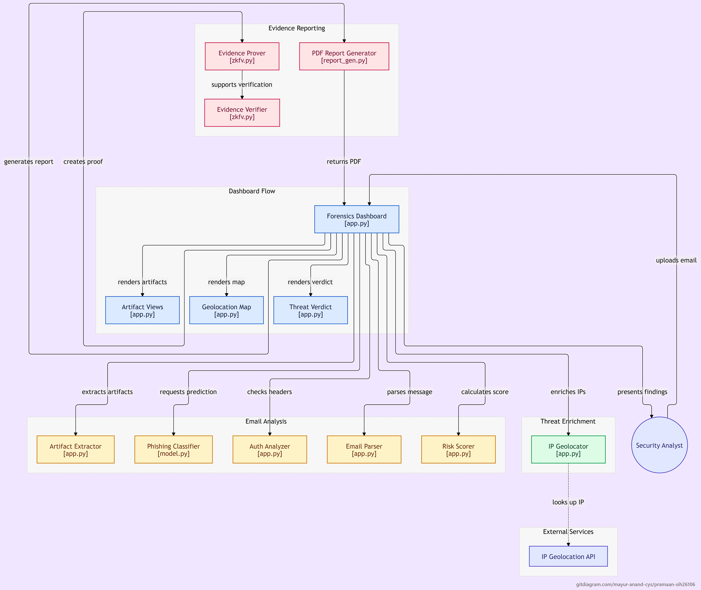

### End-to-End Processing Pipeline

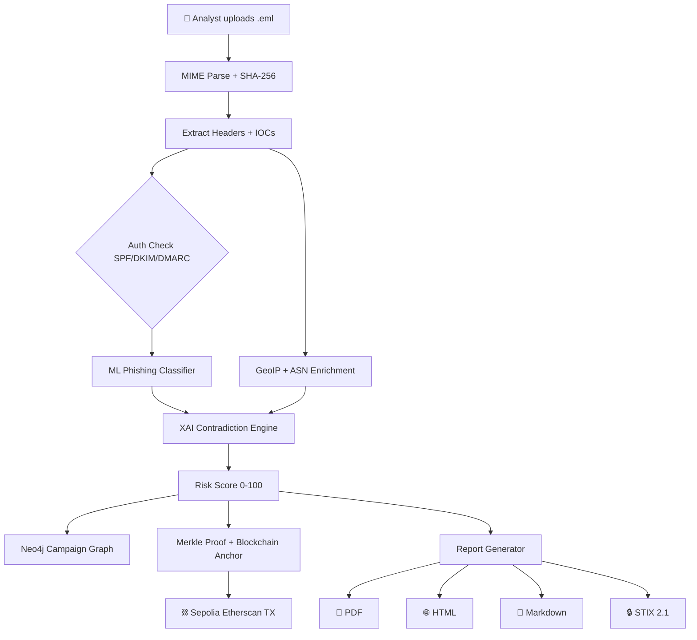

---

## 🗺️ Geolocation Inference Cascade

To handle the industry-wide problem where webmail clients (Gmail, Outlook) strip client IPs from headers, TRINETRA implements a **multi-tier fallback** to locate the sender's origin:

| Tier | Forensic Indicator | Example | Reliability |
|------|--------------------|---------|-----------|
| 1 | Direct source IP from Received-SPF | `client-ip=103.108.118.85` | High |
| 2 | Domain mail infrastructure (MX DNS) | `@ippbonline.co.in` → MX IP | High |
| 3 | Client machine clock offset | `Date: ... +0530` | Medium |
| 4 | ccTLD sovereign jurisdiction | `.in`, `.gov.in`, `.ru` | Medium |
| 5 | Regional webmail provider | `rediffmail.com` → Mumbai | Medium |
| 6 | Indic script & entity corroboration | Devanagari, ₹ / INR, RBI | Low-Medium |
| 7 | Global mail hub baseline | Provider global infrastructure | Low |

---

## 🖥️ Prototype Walkthrough

### 1. Triage Overview — Threat Score & XAI Verdict

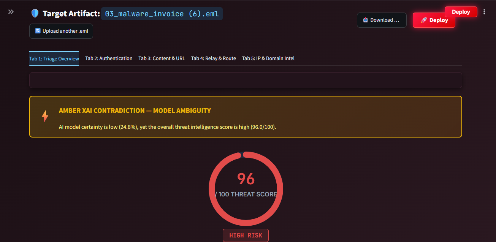

Real-time threat scoring with the XAI contradiction banner. This email scored **96/100** with a critical contradiction alert visible at the top.

---

### 2. Executive Incident Verdict & Factor Weight

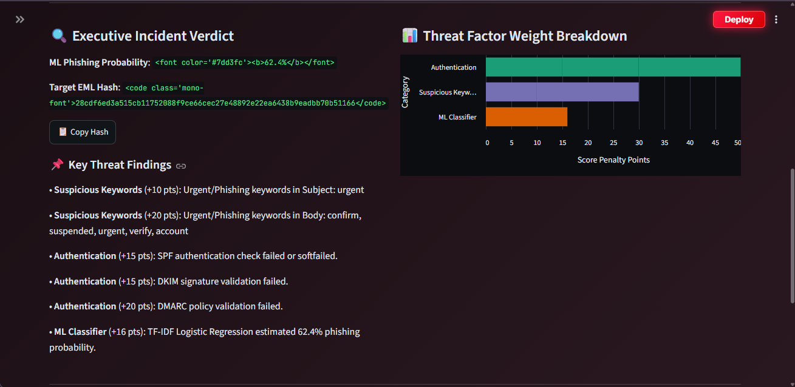

Plain-English verdict alongside a weighted factor chart showing exactly which indicators drove the score.

---

### 3. Authentication Matrix — SPF / DKIM / DMARC / ARC

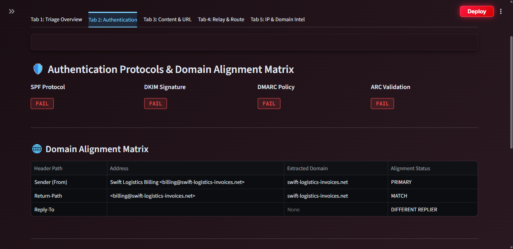

Cryptographic auth check results plus domain alignment matrix. Instantly reveals spoofing attempts.

---

### 4. Content Analysis — URLs & Stacked Factors

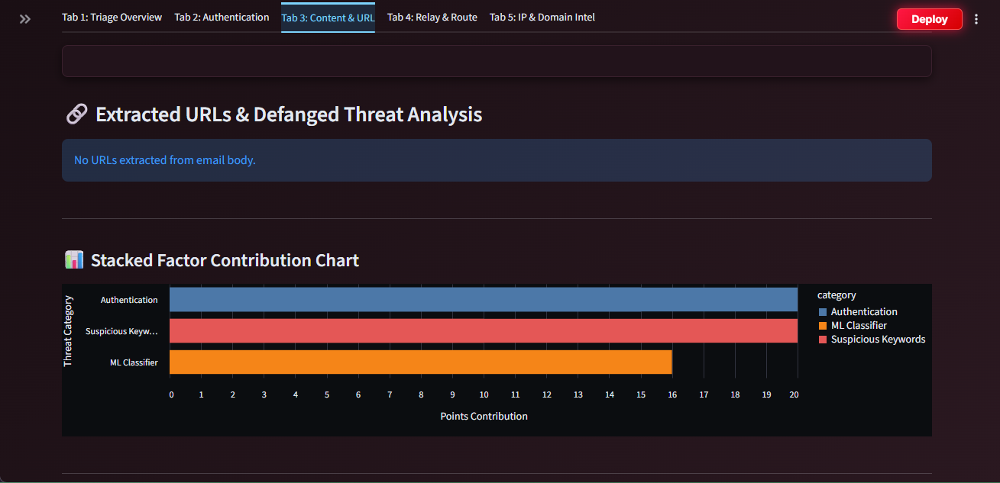

Extracted URLs with a stacked factor chart breaking down the contribution of each suspicious content signal.

---

### 5. Extracted MIME Headers

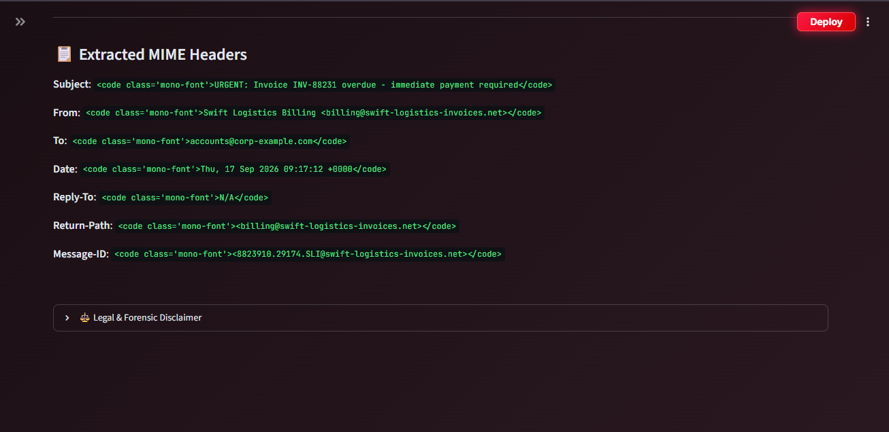

Raw MIME header dump with PII-masked values for DPDP Act 2023 compliance.

---

### 6. Relay Chain Timeline

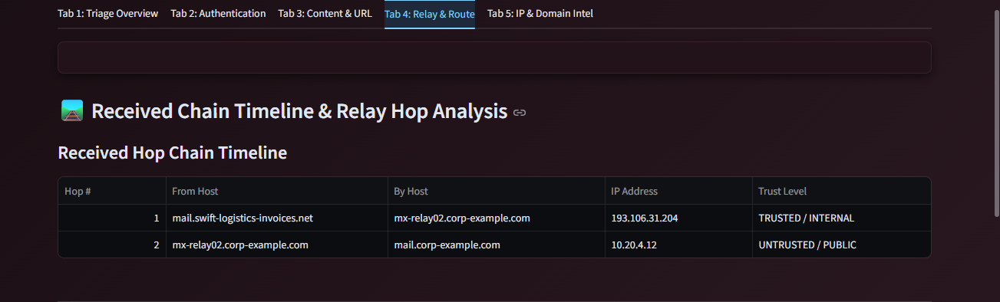

Per-hop relay timeline showing the path the email took, with trust levels per hop.

---

### 7. Threat Infrastructure Relationship Graph

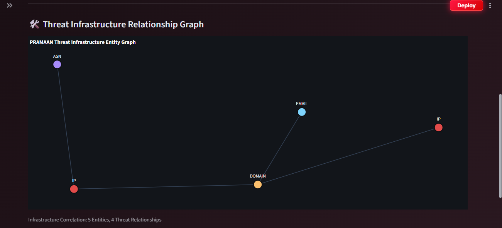

NetworkX graph linking IPs, URLs, and domains from the email. Reveals shared infrastructure with past campaigns.

---

### 8. Geolocation Map

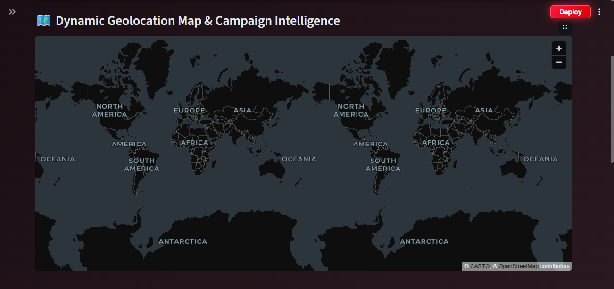

World map showing the attacker's infrastructure origin — city, country, ASN, and ISP.

---

### 9. IP & ASN Resolution + Neo4j Status

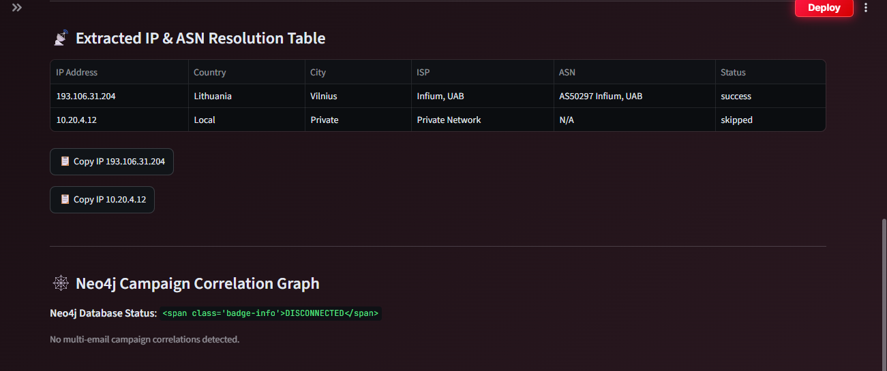

Detailed IP intelligence table (ASN, ISP, country) and live Neo4j connection status.

## 🧰 Tech Stack

| Layer | Technologies |
|-------|-------------|
| **Backend** | Python 3.10+, FastAPI, Uvicorn, Pydantic v2 |
| **Frontend** | Streamlit, Plotly, Altair |
| **ML / NLP** | scikit-learn (TF-IDF + Logistic Regression), RapidFuzz |
| **Auth / DNS** | dnspython, pyspf, dkimpy |
| **Threat Intel** | ip-api.com (GeoIP + ASN), RDAP, VirusTotal, AbuseIPDB, Shodan |
| **Graph** | Neo4j 5.x, NetworkX |
| **Blockchain** | Web3.py, Solidity `TrinetraEvidence.sol`, Ethereum Sepolia |
| **Reports** | ReportLab (PDF), HTML, Markdown, STIX 2.1 |
| **Storage** | SQLite (evidence ledger), Neo4j (campaign graph) |
| **Deployment** | Docker, docker-compose |

---

## 🚀 Quick Start

### Prerequisites

- Python 3.10+
- Git
- Docker (for Neo4j)

### 1. Clone and set up

```bash
git clone https://github.com/thinkapoorv/Trinetra-Email.git
cd Trinetra
python -m venv .venv
source .venv/Scripts/activate      # Windows Git Bash
# source .venv/bin/activate         # Linux / macOS
pip install -r requirements.txt
```

### 2. Start Neo4j

```bash
docker-compose up neo4j -d
```

Neo4j runs at `bolt://localhost:7687`. Default credentials: `neo4j` / `trinetra_dev`.

### 3. Start the dashboard

```bash
streamlit run app.py
```

Opens at `http://localhost:8501`. Upload any `.eml` file → analysis runs → PDF report downloads.

### 4. (Optional) Start the API

```bash
uvicorn api:app --reload --port 8000
```

API docs at `http://localhost:8000/docs`.

---

## ⚙️ Environment Configuration

Copy `.env.example` to `.env` and fill in optional keys. All keys are **optional** — missing keys degrade gracefully.

```bash
# Neo4j
NEO4J_URI=bolt://localhost:7687
NEO4J_USER=neo4j
NEO4J_PASSWORD=trinetra_dev

# Threat Intel Feeds (all optional)
VIRUSTOTAL_API_KEY=
ABUSEIPDB_API_KEY=
IPINFO_TOKEN=
URLSCAN_API_KEY=
GOOGLE_SAFE_BROWSING_API_KEY=
SHODAN_API_KEY=
CENSYS_API_ID=
CENSYS_API_SECRET=

# Redis cache (optional - falls back to in-memory)
REDIS_URL=redis://localhost:6379/0
```

---

## 🧪 Testing

Run the full test suite:

```bash
pytest tests -q
```

**Current test coverage:**

- `test_auth_check.py` — SPF / DKIM / DMARC parsing
- `test_intel_aggregator.py` — Threat intel aggregation
- `test_thread_hijack.py` — Thread hijack detection
- `test_typosquat.py` — Brand lookalike detection
- `test_xai.py` — XAI contradiction engine

---

## 📁 Repository Structure

```
Trinetra/
├── app.py                       # Streamlit UI
├── api.py                       # FastAPI backend
├── model.py                     # ML phishing classifier
├── threat_intel.py              # GeoIP + ASN enrichment
├── graph_engine.py              # NetworkX infrastructure graph
├── neo4j_engine.py              # Neo4j campaign correlation
├── xai_engine.py                # XAI contradiction detection
├── zkfv.py                      # Merkle proof generation
├── report_gen.py                # PDF report generator
├── report_canvas.py             # NumberedCanvas (Page X of Y)
├── report_html.py               # HTML export
├── report_markdown.py           # Markdown export
├── report_stix.py               # STIX 2.1 export
├── security_hardening.py        # Defense modules
├── blockchain/                  # Smart contracts + anchoring
│   ├── anchor.py
│   ├── merkle.py
│   └── contracts/TrinetraEvidence.sol
├── backend/
│   ├── auth/                    # PBKDF2 login + SQLite user DB
│   ├── detection/               # Thread hijack detection
│   ├── intel/                   # Threat intel aggregator
│   ├── reporting/pii_mask.py    # DPDP Act PII masking
│   └── typosquat/               # Brand lookalike detection
├── tests/                       # Pytest suite
├── docs/                        # PRD + architecture
├── trinetra/                     # CLI + citizen view
└── requirements.txt
```

---

## 👥 Trinetra Team

| Role | Name | GitHub |
|------|------|--------|
| 👑 Team Lead | Abhi | [@thinkapoorv](https://github.com/thinkapoorv) |
| 🛡️ Member | Abhi | [@thinkapoorv](https://github.com/shreyagarje07-star) |
| 🛡️ Member | Abhi | [@thinkapoorv](https://github.com/thinkapoorv) |
| 🛡️ Member | Abhi | [@thinkapoorv](https://github.com/Abhi) |
| 🛡️ Member | Abhi | [@thinkapoorv](https://github.com/thinkapoorv) |

**Institute / College:** Trinetra Engineering  
**Team ID:** TRINETRA-CORE

---

## 📜 Compliance

- **DPDP Act 2023** — PII masking in all exported reports (`backend/reporting/pii_mask.py`)
- **Cryptographic chain of custody** — SHA-256 sealing on upload, Merkle root anchored to Sepolia
- **Section 63 BSA 2023** — Court-ready PDF with examiner attestations _(roadmap)_

---

## 📄 License

MIT License — see [LICENSE](LICENSE) for details.